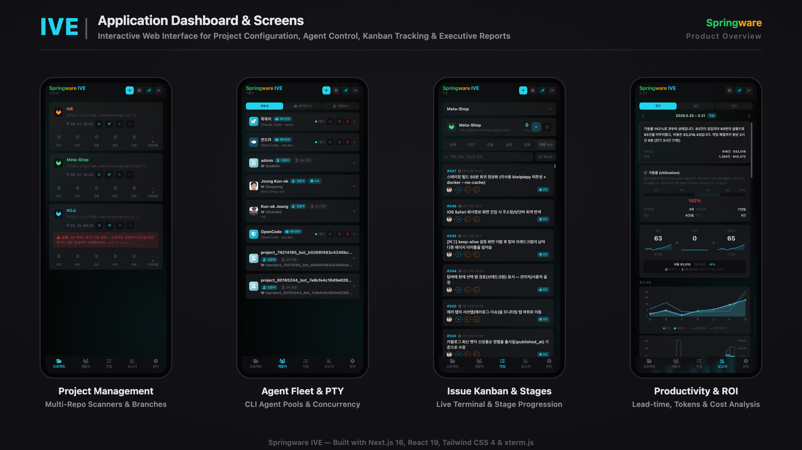
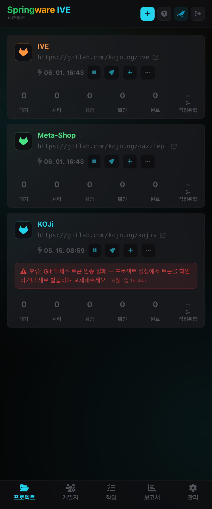
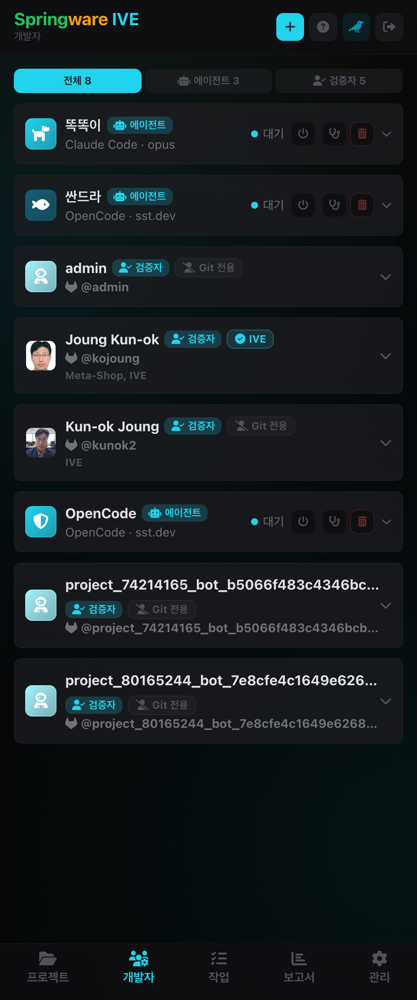
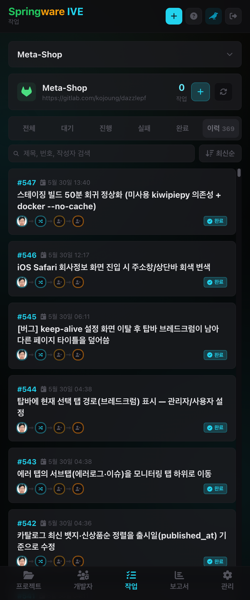
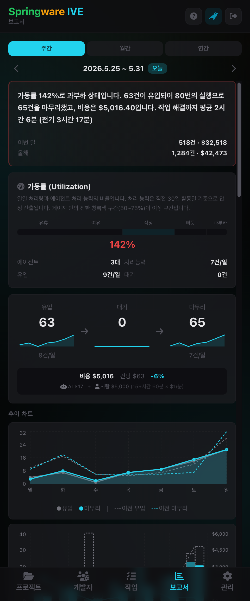
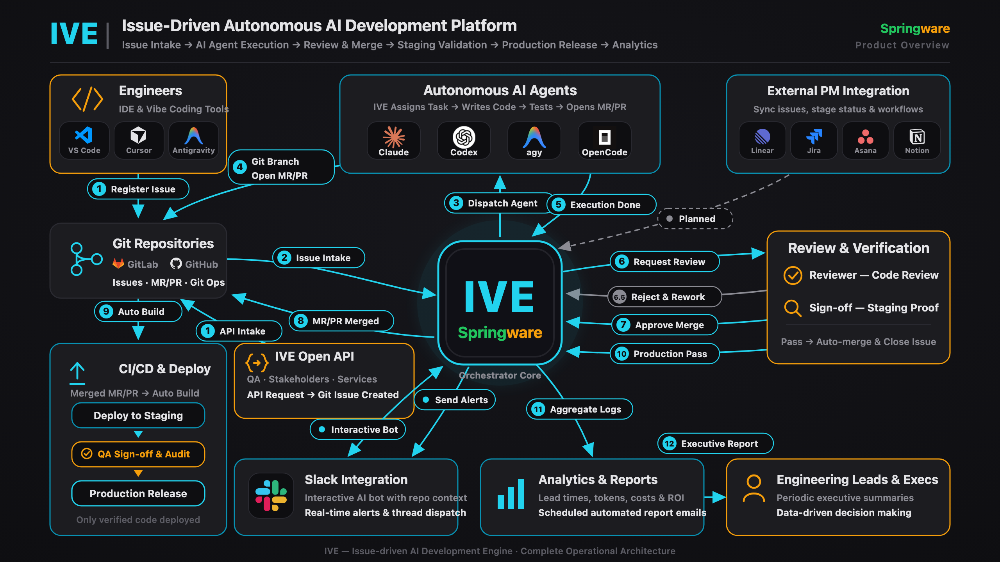

# Springware IVE

> **AI develops, humans manage value.**

[](package.json)
[](https://nextjs.org/)
[](https://react.dev/)
[](https://tailwindcss.com/)
[](https://www.typescriptlang.org/)
[](LICENSE)
[](https://www.youtube.com/watch?v=ue74hXRKOB0)

An integrated automation and orchestration platform where AI agents autonomously resolve GitLab and GitHub issues. From issue polling and automated code generation to testing, MR/PR creation, and structured human-in-the-loop verification, IVE automates the mechanical pipeline so software engineers can focus on architecture, direction, and value judgment.

---

## 🎬 Product Demo Video

[](https://www.youtube.com/watch?v=ue74hXRKOB0)

> 🍿 **[Watch the full demo on YouTube](https://www.youtube.com/watch?v=ue74hXRKOB0)** — See how IVE orchestrates autonomous AI CLI agents, monitors live terminal sessions, and streamlines issue verification.

---

## Application Screens & Dashboard



<div align="center">
  <table width="100%">
    <tr>
      <th width="25%" align="center">1. Project Management</th>
      <th width="25%" align="center">2. Agent Fleet & PTY</th>
      <th width="25%" align="center">3. Issue Kanban & Stages</th>
      <th width="25%" align="center">4. Productivity & ROI</th>
    </tr>
    <tr>
      <td width="25%" align="center"></td>
      <td width="25%" align="center"></td>
      <td width="25%" align="center"></td>
      <td width="25%" align="center"></td>
    </tr>
    <tr>
      <td width="25%" valign="top"><small>Register GitLab/GitHub repositories, set polling intervals, configure base/confirm branches, and toggle active scanners.</small></td>
      <td width="25%" valign="top"><small>Manage global CLI agent pools (Claude, Agy, Codex, OpenCode), monitor concurrency slots, and inspect real-time shell sessions.</small></td>
      <td width="25%" valign="top"><small>Visual Kanban tracking across all 7 stages with real-time checklist progress, diffs, and live xterm.js terminal streaming.</small></td>
      <td width="25%" valign="top"><small>Data-driven executive metrics: median lead-time, human review ratios, token usage, and cost-savings comparisons.</small></td>
    </tr>
  </table>
</div>

---

## ⚡ Quick Start

IVE runs out of the box with **zero configuration required** — the built-in SQLite database is automatically initialized and migrations applied on first boot without setting up any external databases or `.env` files.

Choose your preferred way to get started:

### 🐳 Method A: Docker (Fastest & Batteries-Included)

The official Docker image includes **Node.js 24**, **Playwright**, and **all major AI CLI agents** (`claude`, `agy`, `codex`, `opencode`) pre-installed. You don't need to configure CLI binaries on your host machine!

#### 1-Line Instant Run (No Clone Needed)
```bash
docker run -d --name springware-ive \
  -p 3000:3000 \
  -v ive-data:/app/data \
  dazzlepf/springware-ive:latest
```
> Open **[http://localhost:3000](http://localhost:3000)** in your browser!

#### Full Stack with Docker Compose (With AI Config Mounts)
```bash
# Clone repository
git clone https://gitlab.com/kojoung/ive.git && cd ive

# Launch container fleet (with persistent auth volumes and test sandbox DB)
docker compose up -d

# View live streaming logs
docker compose logs -f
```
> Open **[http://localhost:3100](http://localhost:3100)** in your browser!

---

### 💻 Method B: Native Node.js & npm (For Local Development)

Ideal if you want to inspect or modify the source code, develop custom modules, or use existing CLI agents already installed on your machine.

#### 1-Line Copy & Paste
```bash
git clone https://gitlab.com/kojoung/ive.git && cd ive && npm install && npm run dev
```

#### Step-by-Step
```bash
# 1. Clone repository
git clone https://gitlab.com/kojoung/ive.git
cd ive

# 2. Install dependencies (Node.js 20+ required)
npm install

# 3. Start development server with live reload & WebSocket terminal
npm run dev
```
> Open **[http://localhost:3000](http://localhost:3000)** in your browser!

---

### 🔑 Default Credentials

| Setting | Default Value | Note |
|---|---|---|
| **Access URL** | `http://localhost:3000` *(or `http://localhost:3100` with Compose)* | Ready immediately |
| **Email** | `admin@ive.local` | Pre-seeded admin account |
| **Password** | `admin` | Change anytime in Admin tab |
| **Database** | `data/springware-ive.db` | Embedded SQLite (zero configuration) |

---

## 🚀 3-Minute Walkthrough: Your First Autonomous Task

Once logged into your IVE dashboard:

1. **Connect a Repository**:
   - Go to the **Projects** tab → click **New Project**.
   - Choose **GitLab** or **GitHub**, enter your repository URL and Personal Access Token (with `api` or `repo` scope).
2. **Confirm Agent Availability**:
   - Go to the **Agents** tab. If you have CLI agents installed on your system (`claude`, `agy`, `codex`, `opencode`), verify their paths and ensure status shows `available`.
3. **Dispatch Issue to AI**:
   - In your GitLab or GitHub repository, add the label **`ive:todo`** to any issue.
   - IVE's scanner picks up the issue, creates an isolated workspace, invokes the agent to edit code and run tests, and automatically submits a ready-to-review Merge/Pull Request!

---

## Overview & Architecture

```mermaid
flowchart LR
    A["GitLab / GitHub Issue\n(ive:todo)"] -->|Scanner polls| B["AI Agent Execution\n(ive:doing)"]
    B -->|Code edit + MR/PR| C["Verification Waiting\n(ive:verify-wait)"]
    C -->|Review & Tests| D["Verification In-Progress\n(ive:verifying)"]
    D -->|Merge to branch| E["Confirmation Waiting\n(ive:confirm-wait)"]
    E -->|Deploy / Staging check| F["Confirmation In-Progress\n(ive:confirming)"]
    F -->|Sign-off| G["Complete\n(ive:done)"]
```





1. **Issue Detection**: The background scanner detects issues marked with `ive:todo` on your registered repositories.
2. **Autonomous Development**: An agent from the CLI pool clones the repository into an isolated workspace, writes the code, verifies builds, and creates a Merge/Pull Request.
3. **Structured Verification & Confirmation**: The MR undergoes reviewer validation (`ive:verify-wait` → `ive:verifying`) and production/staging proof (`ive:confirm-wait` → `ive:confirming`) before closure.
4. **Automated Analytics & Reporting**: Accurate duration, token consumption, and cost calculations are extracted from machine-readable metadata (`ive-meta`) and presented in executive productivity reports.

---

## Key Features

- **Multi-CLI Agent Support**: First-class support for **Claude Code** (`claude`), **Antigravity** (`agy`), **Codex** (`codex`), **OpenCode** (`opencode`), and **Gemini CLI**.
- **Dual Git Provider**: Seamlessly integrates with both **GitLab** and **GitHub** projects using unified token management and API dispatching.
- **Stage Lifecycle Management**: Strictly enforced single-stage labeling (`todo` → `doing` → `verify-wait` → `verifying` → `confirm-wait` → `confirming` → `done`).
- **Checklist-Based Progress Tracking**: Parses markdown checkboxes (`- [ ]` / `- [x]`) within issue bodies to calculate real-time stage progress.
- **Real-Time Terminal Streaming**: Watch live agent console logs via **xterm.js** over WebSockets / node-pty with process group kill controls.
- **Executive ROI & Productivity Reports**:
  - Lead-time median / P90 distributions.
  - Work balance and human review metrics across projects.
  - AI token consumption vs. human labor cost-savings comparison.
  - Periodic automated email reports (Daily / Weekly / Monthly).
- **Slack Workspace Integration**: Two-way Slack bot integration with stage notification alerts, user mentions, and interactive thread sessions.
- **Enterprise-Grade Security**: AES-256-GCM encryption for stored Git access tokens; automated sanitization of sensitive environment variables from terminal sub-shells.
- **Bilingual Interface**: Full internationalization (`next-intl`) support for English and Korean.

---

## Issue Lifecycle & Label Conventions

IVE synchronizes state with remote issues using a single active stage label:

| Label | Stage | Description |
|---|---|---|
| `ive:todo` | Schedule / Waiting | Issue queued for autonomous agent dispatch. |
| `ive:doing` | Development | Assigned AI agent is cloning, modifying code, or pushing branches. |
| `ive:verify-wait` | Verification Waiting | Code changes pushed and MR/PR opened; waiting for reviewer validation. |
| `ive:verifying` | Verifying | Reviewer / verification sub-agent is actively inspecting code and tests. |
| `ive:confirm-wait` | Confirmation Waiting | Changes merged; awaiting staging/production deployment proof. |
| `ive:confirming` | Confirming | Verifier / tester is actively validating running deployment. |
| `ive:done` | Done | Verification and confirmation approved; issue automatically closed. |

### Progress Checklists
IVE calculates task completion percentages directly from checkboxes in the issue description:
```markdown
## Implementation
- [x] Add user verification endpoint
- [ ] Connect Slack notification handler

## Verification
- [ ] Pass vitest integration suite
- [ ] Test mobile responsiveness
```

### Machine-Readable Metadata (`ive-meta`)
Appended to issue descriptions or closing notes for automated cost, token, and duration analytics:
```html
<!-- ive-meta
model: claude-3-7-sonnet
input_tokens: 14200
output_tokens: 1850
cost_usd: 0.070
started_at: 2026-10-27T10:00:00+09:00
ended_at: 2026-10-27T10:24:00+09:00
-->
```

---

## Configuration & Environment Variables

| Variable | Description | Default |
|---|---|---|
| `PORT` | Web server listening port | `3000` |
| `NODE_ENV` | Runtime environment (`development` / `production`) | `development` |
| `JWT_SECRET` | Secret key for signing session JWT tokens | *Development fallback* |
| `ENCRYPTION_KEY` | AES-256 key for encrypting repository tokens in SQLite | *Development fallback* |
| `WEB_CONCURRENCY` | Worker processes (`auto` or numeric count) | `1` |
| `MAX_TERMINALS` | Maximum concurrent PTY sessions | `100` |
| `SSL_CERT` / `SSL_KEY` | Paths to HTTPS SSL certificate and private key | `/app/ssl/*.pem` |
| `DATABASE_URL` | Custom path to SQLite DB file | `data/springware-ive.db` |
| `MAIL_SMTP_HOST` | SMTP server host for report mailings | — |
| `MAIL_SMTP_PORT` | SMTP port | `587` |
| `MAIL_SMTP_USER` | SMTP username | — |
| `MAIL_SMTP_PASSWORD` | SMTP password | — |

---

## Tech Stack

| Area | Technology |
|---|---|
| **Framework** | Next.js 16 (App Router) with custom `server.ts` (HTTP/HTTPS + WebSockets) |
| **Frontend** | React 19, Tailwind CSS 4, xterm.js, Recharts, FontAwesome |
| **Backend & Shell** | Node.js (v20+), `node-pty`, `ws` WebSocket server |
| **Database** | SQLite via `better-sqlite3` with indexed time-series snapshots |
| **Authentication** | JWT (`ive-token` cookie) + bcryptjs password hashing |
| **Encryption** | AES-256-GCM token encryption (`crypto`) |
| **Logging** | Pino, Pino-Roll, Pino-Pretty |
| **Testing** | Vitest (unit & integration tests) |

---

## Project Structure

```
├── server.ts                 # Custom HTTP/HTTPS server + WebSockets (node-pty + chat)
├── src/
│   ├── app/                  # Next.js App Router pages & API routes
│   │   ├── api/              # REST API (agents, auth, executions, projects, reports, slack)
│   │   ├── globals.css       # Semantic IVE Tailwind CSS design tokens
│   │   └── page.tsx          # Main multi-tab application dashboard
│   ├── components/           # Reusable React UI components
│   │   ├── agent/            # Agent management & avatar cards
│   │   ├── execution/        # Terminal view & execution inspector
│   │   ├── issue/            # Kanban board & issue stage cards
│   │   ├── project/          # Project connection & credential dialogs
│   │   ├── report/           # Analytics charts, summaries, and productivity tables
│   │   ├── tabs/             # Tab views: ProjectsTab, IssuesTab, AgentsTab, ReportsTab, AdminTab
│   │   └── ui/               # Standardized design system elements (buttons, modals, badges)
│   ├── i18n/                 # next-intl internationalization configuration
│   ├── messages/             # Localization dictionary JSONs (ko, en)
│   └── lib/                  # Core application libraries
│       ├── db/               # SQLite modular queries and schema migrations
│       ├── scanner/          # Issue polling, CLI runner, git ops, MR/PR creation
│       ├── gitlab/           # GitLab REST API client
│       ├── github/           # GitHub REST API client
│       ├── provider.ts       # Unified Git provider dispatcher
│       ├── stage-transitions.ts # Stage transition rules & label updates
│       ├── report-model/     # Productivity & lead-time aggregation engine
│       ├── report-mailer/    # Automated HTML report generator & SMTP sender
│       └── slack.ts          # Slack bot integration & event handlers
├── tests/                    # Vitest unit and integration test suite
├── data/                     # Persistent SQLite DB and execution log directory
└── workspaces/               # Ephemeral Git repo checkouts (auto-cleaned)
```

---

## 🛠️ Scripts & Commands

```bash
# Start local development server (with HMR & live WebSockets)
npm run dev

# Run Vitest test suite
npm run test

# Run tests in watch mode
npm run test:watch

# Code style & lint check
npm run lint

# Build production Next.js bundle
npm run build

# Start production server (runs custom server.ts)
npm start
```

---

## License

This project is licensed under the [MIT License](LICENSE).
